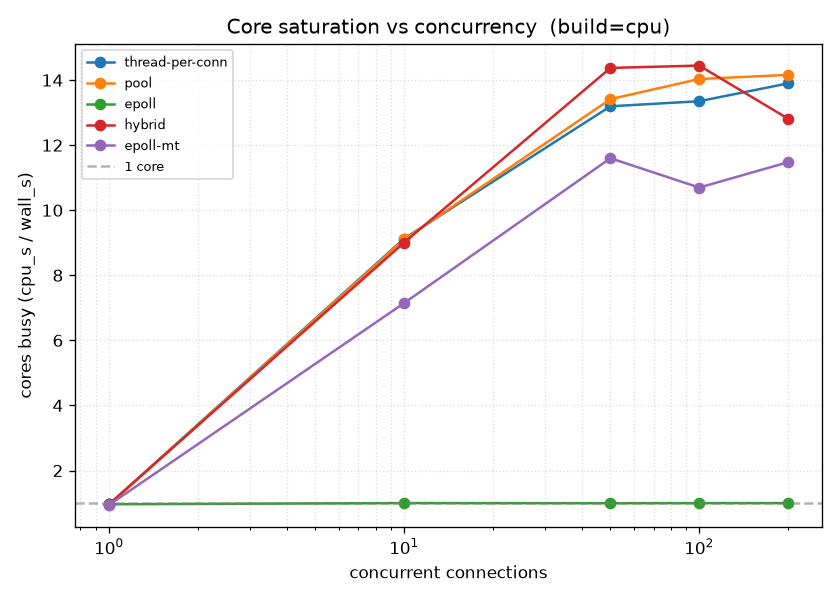
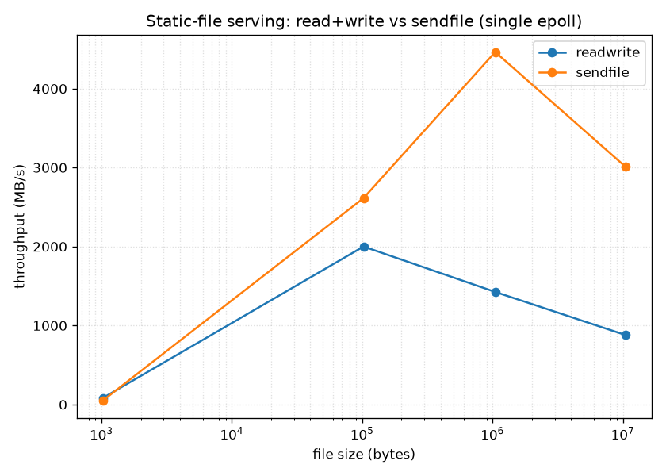
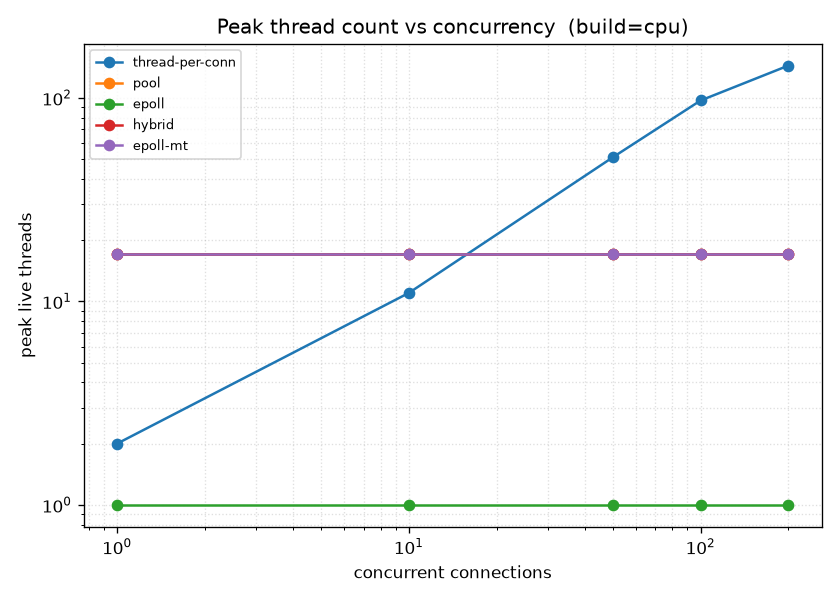
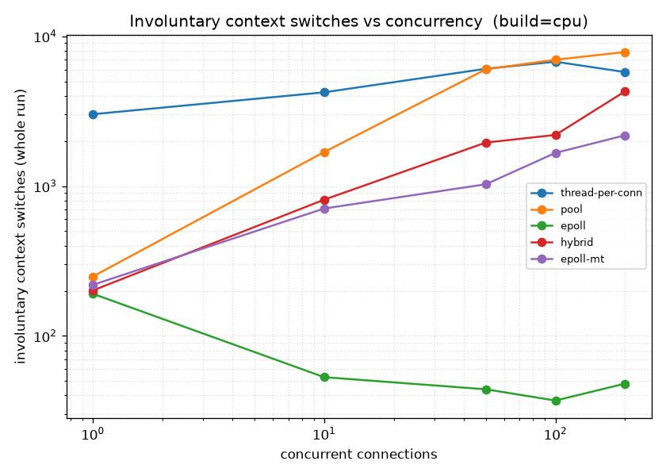

# Designing and Optimizing a Linux HTTP Server

A from-scratch C++ study in **performance engineering of a Linux HTTP server across I/O, CPU
scheduling, and concurrency.** It follows one engineering loop end to end:

> **baseline → benchmark → find the bottleneck → re-architect → benchmark → quantify.**

The project starts by comparing three classic concurrency models, uses in-process and OS-level
instrumentation to *prove why* each one wins or loses, then **engineers past the bottleneck it
measures** with two synthesis architectures — and closes with systems optimizations
(HTTP keep-alive, zero-copy `sendfile`), a coordinated-omission-aware benchmark harness, and
production hardening. The point is not the server; it is the **measurement and the mechanism.**

---

## The headline

Single-threaded `epoll` is measured to **collapse to one core (358 req/s)** under CPU-bound load
while the machine has 16. Two different re-architectures recover the cores:

| architecture | strategy | CPU-bound throughput | cores used |
|---|---|---|---|
| single `epoll` (baseline) | one thread, one loop | **358 req/s** | **1.0 / 16** |
| **hybrid** (epoll + worker pool + eventfd) | offload *CPU work* to a pool | **4,234 req/s** (11.8×) | ~13 |
| **epoll-mt** (`SO_REUSEPORT`) | N loops, kernel spreads *connections* | **3,487 req/s** (9.8×) | ~11 |
| thread pool (reference) | 16 blocking workers | 4,469 req/s | ~14 |

The two synthesis architectures are *two different answers to the same bottleneck*, and they have
**different failure modes** (below) — which is the interesting part.



*Every architecture except single-epoll (green, pinned flat on the 1-core line) climbs toward the
core count. This one graph is the thesis of the project.*

---

## The four groups

1. **Baseline architectures** — thread-per-connection, thread pool, single-threaded epoll
2. **Synthesis architectures** — hybrid (epoll + worker pool + `eventfd`); multi-threaded epoll + `SO_REUSEPORT`
3. **Systems optimizations** — HTTP keep-alive; `sendfile()` vs `read()`+`write()`
4. **Instrumentation** — throughput, p50/p95/p99, core utilization, context switches, thread counts

All architectures share one request handler and one non-blocking HTTP/1.1 state machine; they differ
only in **how concurrency and CPU work are scheduled.** Workloads are selectable: `none` (echo),
`cpu` (~3 ms of irreducible xorshift compute — stands in for CPU-bound work), `sleep` (100 ms wait —
stands in for I/O-bound work).

---

## Group 1 — Baseline architectures, and the bottleneck

Three models, one handler:

1. **thread-per-connection** — a detached `std::thread` per connection. Concurrency = connection count (unbounded).
2. **thread pool** — `N` workers pull connections from a `mutex`+`condvar` queue. Concurrency capped at `N`.
3. **single-threaded epoll** — one thread, non-blocking sockets, a full read/write state machine (partial reads reassembled to `\r\n\r\n`, `EPOLLOUT` for partial writes, `timerfd` to simulate I/O waits without blocking the loop).

The comparison already shows **there is no single best architecture** — the winner flips with the
nature of the work:

| workload | best | worst | why |
|---|---|---|---|
| **CPU-bound** | thread pool (~4.4k req/s) | **epoll (358 req/s)** | CPU needs many cores; epoll's one thread uses one |
| **I/O-bound** | epoll & thread-per-conn (~4.4k) | **thread pool (159 req/s)** | waiting is cheap; the pool's 16 workers cap concurrent waits |
| **C10k churn** | thread pool (~77k) | **thread-per-conn (706 timeouts)** | per-connection syscalls need cores; thread-per-conn drowns in thread churn |

**The bottleneck this exposes:** single-threaded epoll trades multi-core throughput for near-zero
per-connection cost. It wins when connections idle, but a single core is a hard ceiling when they are
busy. The rest of the project is about **engineering past that ceiling** — and instrumenting *why* it
exists.

 

---

## Group 2 — Synthesis architectures (engineering past the ceiling)

### Hybrid: epoll I/O thread + CPU worker pool + `eventfd`

One epoll thread owns all sockets and the state machine. When a request needs CPU work, the epoll
thread packages a job (connection id) onto a task queue and **returns immediately to serving I/O**;
a worker computes the response, pushes it to a completion queue, and wakes the epoll thread by writing
to an **`eventfd` registered in epoll**. The epoll thread drains completions and writes them out
through the same `EPOLLOUT` path.

- Cross-thread safety uses **fd-as-id** (look-up-or-drop), never a raw pointer into the connection map.
- The offloaded fd is **parked** (`EPOLL_CTL_MOD` to 0 interest) so it can't busy-spin while a worker runs.
- Result: **358 → 4,234 req/s (11.8×)**, ≈95% of the thread pool, p99 46 ms vs epoll's 290 ms — *without* the pool's keep-alive weakness (below). A worker holds a job for a few ms, never a whole connection.

### epoll-mt: N independent loops + `SO_REUSEPORT`

`N` threads, each with its **own** listening socket bound with `SO_REUSEPORT` and its own epoll loop.
The kernel load-balances connections across the listeners (how nginx scales). No shared connection
state → **no hot-path locking.** Result: **357 req/s at 1 loop (identical to single-epoll) → 3,487 at
16 (9.8×).**

**The interesting difference — two strategies, two failure modes.** The pool/hybrid pull from a
*shared queue* (balanced per **request**); `SO_REUSEPORT` assigns a whole **connection** to a loop up
front. So under uneven per-connection cost, some loops overload while others idle → epoll-mt tops out
at ~11 cores (not ~14) and its p99 is far worse (221 ms vs hybrid's 62 ms at c=200). Same goal,
genuinely different tradeoff — a comparison most projects never reach.

---

## Group 3 — Systems optimizations

### HTTP keep-alive

The epoll server became a real event-driven HTTP/1.1 server: per-connection state, a pragmatic
parser, keep-alive, and correct draining of **pipelined requests batched in one `recv`** (a subtle
level-triggered-epoll bug: once bytes are read out of the kernel buffer no further `EPOLLIN` fires, so
all buffered requests must be parsed in a loop). Keep-alive removes a TCP handshake per request:
**+50% throughput on epoll** (65k → 98k req/s), and up to **8–11×** on the blocking archs.

This surfaced a real finding: **keep-alive breaks the thread pool's concurrency model.** A pool worker
sits in one connection for its whole lifetime, so effective concurrency collapses to `--workers` and
connections beyond that starve (p50 21 µs but p99 6.8 ms). The hybrid has no such failure — connections
live on the epoll thread, not on workers.

### `sendfile()` vs `read()`+`write()`

Static files served two ways: bytes copied through userspace (`read+write`) vs zero-copy kernel→socket
(`sendfile`), with the non-blocking `EPOLLOUT` resume tracking a per-connection file offset. Verified
byte-identical (md5) including a 1 MB response that exceeds the socket buffer.



| file size | read+write | sendfile |
|---|---|---|
| 1 KB | **83 MB/s** | 51 MB/s |
| 100 KB | 2001 MB/s | **2614 MB/s** |
| 1 MB | 1426 MB/s | **4464 MB/s** |
| 10 MB | 880 MB/s | **3010 MB/s** (~3.4×) |

Below ~100 KB the extra syscall makes `sendfile` a slight loss; above it, zero-copy wins big —
`read+write` goes memory-bandwidth-bound once the file outgrows cache, while `sendfile` stays flat.

**Bonus war story:** sending headers and body in two syscalls stalled small-file `sendfile` **~40 ms
per request** — the classic **Nagle's-algorithm / delayed-ACK** interaction. Setting **`TCP_NODELAY`**
on accepted sockets took 1 KB `sendfile` from 1,219 → **52,606 req/s.**

---

## Group 4 — Instrumentation (proving *why*)

A `/proc` CPU sampler (`bench/cpu_sampler.py`) plus in-server `getrusage(RUSAGE_SELF)` on `SIGTERM`
(which aggregates *exited* threads — essential for thread-per-conn's churn) turn every result from a
claim into a mechanism.

 

- **Core saturation** (top graph): epoll pinned at **1.0 core** — its 358 req/s ceiling, made visible.
- **Thread counts:** thread-per-conn explodes to 160+ threads with concurrency; the epoll family stays flat (1 loop, or a fixed pool).
- **Context switches:** epoll pays **near-zero** involuntary switches (one thread is never preempted for a peer). thread-per-conn's signature is its **floor** — ~1 involuntary switch *per request* even at concurrency 1, a fixed thread-churn tax the persistent-worker archs don't pay.

### Benchmark methodology — fixing coordinated omission

The load generator adds an **open-loop mode** (`--rate R`): each request has an *intended* send time,
and latency is measured against that schedule (threads phase-staggered to avoid a synthetic thundering
herd). So when the server saturates, requests that *should* have been sent are charged their queuing
delay — the tail a closed-loop generator structurally hides.

| driving epoll (cpu, ~360 req/s ceiling), c=50 | actual throughput | p99 |
|---|---|---|
| closed-loop | 343 req/s | **273 ms** *(the comfortable lie)* |
| open-loop @ 500 (overload) | 345 req/s | **3.8 s** *(the tail a user actually sees)* |
| open-loop @ 100 (healthy) | 100 req/s | **7.5 ms** *(no false inflation)* |

Same server, same throughput, a **14× hidden tail** — coordinated omission, quantified.

---

## Production hardening

- **Idle-connection timeouts** (`--idle-timeout`): a periodic sweep reaps connections still awaiting a
  request past the deadline — **fixes the Slowloris weakness** (verified: a partial-request connection
  is closed after exactly the configured timeout; active connections are never reaped).
- **Backpressure** (`--max-conns`): shed new connections beyond a cap instead of unbounded growth
  (verified 5-of-10 served at cap 5).
- **RAII throughout:** every fd owned by a move-only `Fd` wrapper (`include/fd.hpp`), closed in its destructor.
- **Honest gap:** `SIGTERM` exits cleanly (stats emitted, kernel reclaims all fds — no leaks), but full
  in-flight *drain* across the multi-loop epoll-mt is not implemented.

Both hardening features are **opt-in** — with no flags, the default benchmark behavior is byte-identical.

---

## Design notes

- **CPU work is irreducible** — a data-dependent xorshift chain stored to a `volatile` sink, so `-O2` can't elide it.
- **`timerfd` for epoll's I/O wait** — the blocking archs `usleep`; epoll can't (it would freeze the loop), so it arms a timer exposed as an fd and moves on.
- **`eventfd` doorbell** — the only way a worker thread can wake a thread blocked in `epoll_wait`: it's a counter behind an fd that epoll watches. Coalesced wakeups mean the whole completion queue is drained per wake.

## Known limitations

- **Churn, not idle persistence, at C10k** — the original C10k test closes each connection; the canonical "hold 10k *idle* connections on one thread" result now that keep-alive exists is future work.
- **Loopback only** — no real RTT/loss/congestion.
- **`SIGTERM` drain** — clean exit, but not a graceful in-flight drain (see hardening).
- **Tail confidence** — `sleep` runs use 3000 requests; low-concurrency p99 is noisier.

## Reproduce

```bash
cmake -S . -B build -DCMAKE_BUILD_TYPE=Release && cmake --build build

# full architecture sweep -> results.csv, then baseline graphs
./run.sh
cd analysis && uv run plot.py

# instrumentation (cores / threads / context switches)
bash bench/run_instrumented.sh && (cd analysis && uv run plot_instrumentation.py)

# sendfile size sweep
bash bench/run_sendfile.sh && (cd analysis && uv run plot_sendfile.py)
```

Run one configuration manually:

```bash
# server: --build=<none|cpu|sleep> --arch=<thread-per-conn|pool|epoll|hybrid|epoll-mt> --workers N
#         [--file <path> --io=<readwrite|sendfile>] [--idle-timeout S] [--max-conns N]
build/TCPServer --build=cpu --arch=hybrid --workers 16

# load: [--keep-alive] [--rate R]  (--rate R = open-loop, coordinated-omission-aware)
build/LoadGenerator --concurrency 200 --requests 20000 --keep-alive
```

**Hardware:** Intel Core i7-13620H (10 cores / 16 threads), Linux. **Analysis:** pandas + matplotlib via `uv`.
