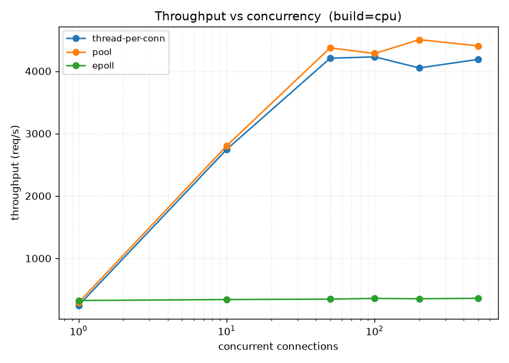
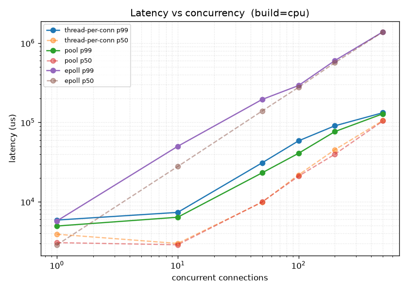
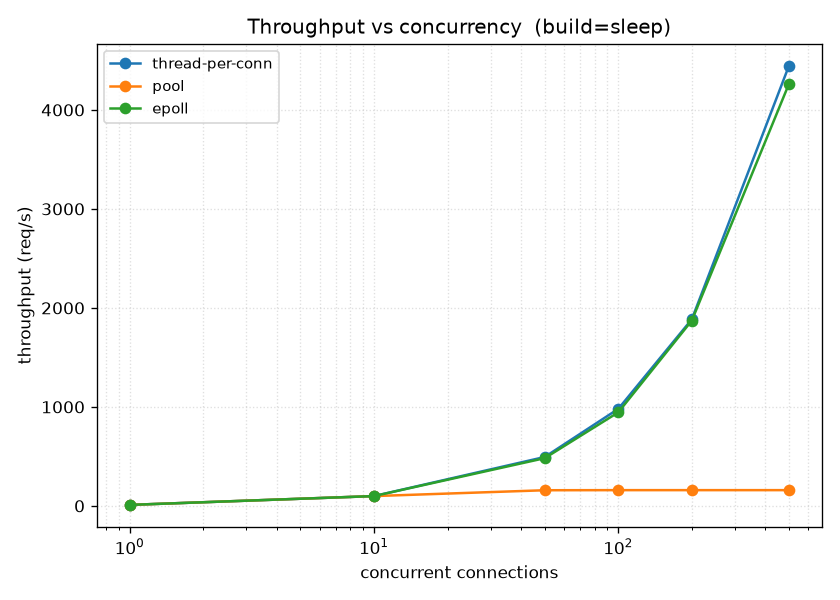
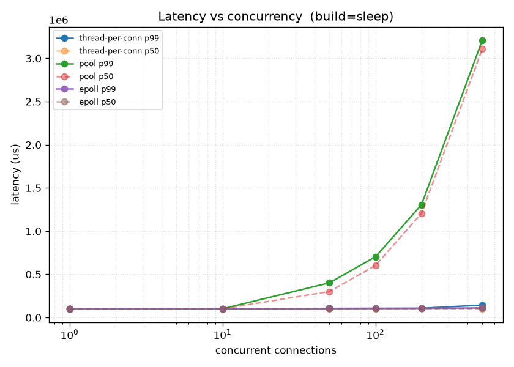
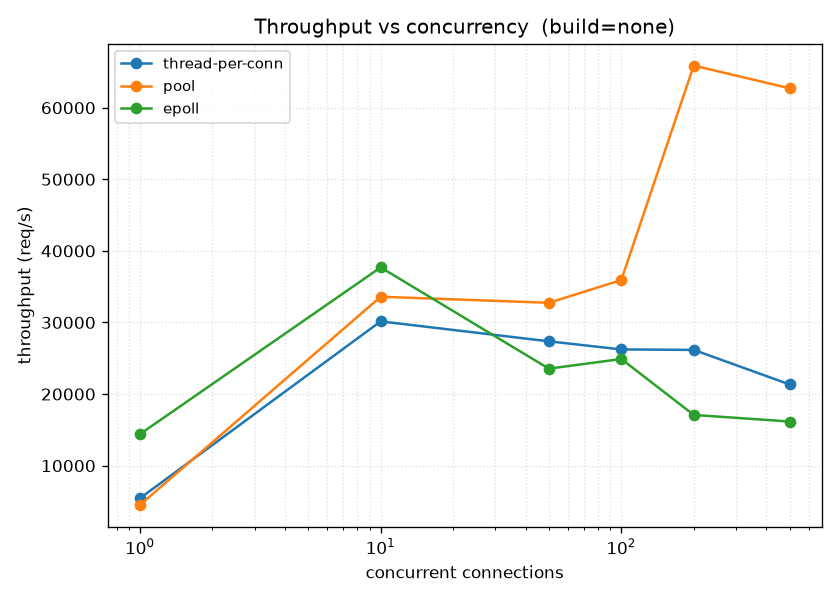

# Server Concurrency Benchmark: thread-per-connection vs. thread pool vs. epoll

A from-scratch C++ study of three server concurrency models under load, measuring
latency (p50/p95/p99) and throughput across three workload types. The point of the
project is not the server — it is the **measurement and the explanation of *why* each
architecture wins or loses in each regime.**

**Headline result: there is no single best architecture.** The right choice is dictated by
the *nature of the work* — CPU-bound, I/O-bound, or connection-handling — and different
regimes produce *opposite* winners. The unifying principle: **single-threaded epoll trades
multi-core throughput for near-zero per-connection cost**, so it wins only when connections
are mostly idle, while a core-sized thread pool wins whenever there is real work to spread
across cores.

---

## TL;DR

| Workload | Best | Worst | Why |
|---|---|---|---|
| **CPU-bound** | thread pool (~4.4k req/s) | **epoll (360 req/s)** | CPU work needs many cores; epoll's single thread uses one |
| **I/O-bound** | epoll & thread-per-conn (~4.4k req/s) | **thread pool (159 req/s)** | waiting is cheap; the pool's fixed workers cap concurrent waits |
| **10k-connection churn** | thread pool (~77k req/s) | **thread-per-conn (706 timeouts)** | per-connection syscalls need cores; epoll is single-core-bound; thread-per-conn drowns in thread churn |

The **same design property flips from asset to liability** with the workload: the pool's
fixed workers win for CPU and connection-handling work, but cap concurrency for I/O waits;
epoll's single thread is near-free per connection but limited to one core for real work.

---

## The three architectures

All three share one request handler (`respond`); they differ only in **how concurrency is
achieved**.

1. **thread-per-connection** — the accept loop spawns a new detached `std::thread` per
   connection. Simple; concurrency = connection count (unbounded).
2. **thread pool** — a fixed set of `N` worker threads (`--workers`) pull connection fds
   from a shared `std::queue` guarded by a `std::mutex` + `std::condition_variable`.
   Concurrency is capped at `N`; excess connections wait in the queue.
3. **epoll event loop** — a single thread with non-blocking sockets and `epoll_wait`.
   Partial reads are reassembled per-connection (`fd → buffer` map) until the `\r\n\r\n`
   header terminator arrives. I/O-bound work is simulated **without blocking the thread**
   via `timerfd`: instead of sleeping, the handler arms a timer, registers it with epoll,
   and sends the response when the timer fires (see *Design notes*).

## Methodology

- **Load generator** (`src/load_gen.cpp`): N worker threads released simultaneously by a
  `std::latch` (fair start), each looping requests over a fresh connection per request
  (`connect → send → recv → close`). Per-thread latency vectors are merged, sorted, and
  reduced to p50/p95/p99/min/max + throughput after all threads join.
- **Work modes** (`--build`): `none` (write response immediately), `cpu` (~3 ms of
  irreducible xorshift compute per request — a stand-in for CPU-bound work), `sleep`
  (100 ms wait per request — a stand-in for I/O-bound work).
- **Sweep** (`run.sh`): every `architecture × work-mode × concurrency` combination; the
  server is started, probed for readiness, driven, and killed per run; results appended to
  `results.csv`. Concurrency ∈ {1, 10, 50, 100, 200, 500}; 3000 requests/run.
- **Scale test** (`wrk`): the custom generator is itself thread-per-connection, so it can't
  cleanly drive 10k connections (its own threads would saturate the machine). The C10k
  sweep therefore uses `wrk` (an epoll-based load tool) at 1k / 5k / 10k connections.
- **Hardware**: Intel Core i7-13620H (10 cores / **16 logical threads**), Linux.
- **Analysis** (`analysis/plot.py`): pandas + matplotlib; `uv run plot.py`.

---

## Results

### 1. CPU-bound (`--build=cpu`)




At concurrency 500:

| arch | throughput | p99 latency |
|---|---|---|
| thread pool | **4,405 req/s** | 129 ms |
| thread-per-conn | 4,188 req/s | 133 ms |
| **epoll** | **360 req/s** | **1,386 ms** |

**Mechanism.** CPU-bound work needs cores. The pool (16 workers) and thread-per-conn both
spread work across all 16 logical cores and plateau near ~4.4k req/s — the machine's
compute ceiling for ~3 ms requests. **epoll collapses to one core**: its single thread can
only run one xorshift loop at a time, so throughput is flat at ~360 req/s (≈ 1 core ÷ 3 ms)
regardless of concurrency, and its p99 explodes to **1.4 seconds** as work backs up behind
the one thread. A single-threaded event loop cannot parallelize computation.

### 2. I/O-bound (`--build=sleep`)




At concurrency 500:

| arch | throughput | p99 latency |
|---|---|---|
| thread-per-conn | **4,448 req/s** | 144 ms |
| epoll | **4,265 req/s** | 111 ms |
| **thread pool** | **159 req/s** | **3,110 ms** |

**The inversion.** A waiting request costs almost nothing, so what matters is *how many
requests can wait at once*. thread-per-conn holds 500 parked threads in parallel; epoll
holds 500 kernel timers on **one** thread — both sustain ~4.4k req/s. The **thread pool is
capped at its 16 workers**: a worker is *fixated* on its request through the entire 100 ms
wait, so only 16 requests are ever in flight (16 ÷ 0.1 s = **160 req/s**, exactly the
measured 159). Excess connections queue, and p99 balloons to **3.1 seconds**. The pool's
bounded concurrency — its CPU-mode strength — is now a hard ceiling.

*epoll matching thread-per-conn here, on a single thread, validates the `timerfd` design.*

### 3. Negligible work (`--build=none`)



Baseline with no per-request work. The pool leads (~63k req/s at concurrency 500) because
bounded concurrency avoids the scheduling/oversubscription overhead that thread-per-conn
(500 threads) and epoll incur; latency climbs for all three as pure connection overhead
accumulates.

### 4. C10k connection scale (`wrk`, no per-request work)

Driven by `wrk` at 10,000 concurrent connections (connection-per-request, so this stresses
connection *churn* — accept/read/write/close — rather than idle persistence):

| arch | throughput | p99 latency | timeouts |
|---|---|---|---|
| **thread pool** | **76,624 req/s** | **164 ms** | **0** |
| epoll | 33,804 req/s | 385 ms | 0 |
| thread-per-conn | 20,401 req/s | 618 ms | **706** |

**Mechanism.** Handling a connection (`accept`/`read`/`write`/`close`) is real per-connection
CPU/syscall work, so it needs cores. The **pool spreads it across all 16 cores** with no
thread churn → 3.75× the throughput of thread-per-conn, lowest tail, zero timeouts.
**epoll is single-*core*-bound**: one thread does every syscall for all 10k connections, so
it tops out at ~34k req/s (one core's syscall ceiling) — clean (0 timeouts) but half the
pool's throughput. **thread-per-conn** creates a thread *per connection* (~20k thread
creates/sec), saturating the scheduler until connections start **timing out (706)**.

This is the key nuance: **single-threaded epoll trades multi-core throughput for near-zero
per-connection cost.** It excels when connections are *idle* (the I/O-bound result above),
but a single core is a ceiling when they are *busy*. Production servers (e.g. nginx) run
**one epoll loop per core** (`SO_REUSEPORT`) to get both — the natural next step here.

*Caveat: because the server closes each connection, this measures 10k churning connections,
not 10k idle-persistent ones. The canonical "hold 10k idle connections on one thread" result
would require HTTP keep-alive (see limitations).*

---

## The thesis

Across four experiments, one principle explains every result:

| regime | the work is... | winner | why |
|---|---|---|---|
| CPU-bound | per-request compute | **pool** | needs all cores; epoll stuck on 1 |
| I/O-bound | per-request waiting | **epoll / thread-per-conn** | cheap concurrent waits; pool's 16 workers bottleneck |
| C10k churn | per-connection syscalls | **pool** | multi-core handling; epoll 1-core-bound; thread-per-conn thread-churn |

- **Bounded concurrency (thread pool):** matching workers to cores *wins* whenever there is
  real work to parallelize (CPU, connection handling), but *caps* concurrency when the work
  is cheap waiting → 28× lower throughput and seconds-long tails under I/O load.
- **A blocking thread per request (thread-per-conn):** fine when the work is *waiting*
  (parked threads are cheap), degrades when it *computes* or *churns* (threads thrash / the
  scheduler saturates and connections time out).
- **A single non-blocking thread (epoll):** **near-free per connection** (its superpower for
  many idle connections), but **limited to one core** for any real per-request or
  per-connection work.

**The unifying insight: single-threaded epoll trades multi-core throughput for near-zero
per-connection cost.** It wins only when the workload is dominated by *idle waiting*; the
pool wins whenever there is work to spread across cores. There is no universal best —
choosing one architecture for all workloads is choosing to lose in some regime.

---

## Known limitations

Honest boundaries of this study, all of which are areas the design deliberately does not
cover:

- **Single-threaded epoll.** The epoll server uses one thread, so it is capped at one core
  for real work (visible in the CPU and C10k results). A production design runs one epoll
  loop per core (`SO_REUSEPORT`) to combine epoll's low per-connection cost with multi-core
  throughput — the clear next step.
- **Churn, not persistence, at C10k.** The server closes each connection, so the 10k test
  measures connection *churn*, not 10k *idle-persistent* connections. epoll's most dramatic
  advantage — holding thousands of idle connections on one thread while thread-per-conn's
  thousands of threads exhaust memory — requires HTTP keep-alive, which is not implemented.
- **epoll write side is synchronous.** The response write is not deferred via `EPOLLOUT`;
  it relies on the ~70-byte response always fitting the socket buffer (true on loopback,
  not on real networks with slow clients). A production epoll server would need a write-side
  state machine.
- **No timeouts.** A slow or stalled client holds resources indefinitely (a Slowloris-style
  weakness). Not relevant to a controlled benchmark; essential for a real server.
- **Tail-latency confidence.** `sleep` runs use 3000 requests, so p99 (and especially
  low-concurrency points) is noisier than the CPU/none runs would support. Percentile
  confidence scales with sample count.
- **Loopback only.** No real network effects (RTT, loss, congestion).

## Design notes

- **`usleep` vs `timerfd`.** The threaded architectures simulate I/O with a blocking
  `usleep` (each has its own thread to block). epoll cannot — one `usleep` would freeze the
  whole event loop — so it uses `timerfd`: a timer exposed as an fd that epoll watches, so
  the single thread starts the wait and moves on. Same 100 ms service time, two mechanisms,
  because the contexts differ.
- **CPU work is irreducible.** The xorshift loop carries a data dependency across
  iterations so `-O2` cannot delete or collapse it; the result is stored to a `volatile`
  sink.

## Reproduce

```bash
# build + run the full sweep -> results.csv
./run.sh

# generate graphs -> analysis/*.png
cd analysis && uv run plot.py
```

Run a single configuration manually:

```bash
# terminal 1 (server): --build=<none|cpu|sleep> --arch=<thread-per-conn|pool|epoll>
build/TCPServer --build=cpu --arch=pool --workers 16

# terminal 2 (load): --concurrency N --requests M
build/LoadGenerator --concurrency 200 --requests 20000
```
